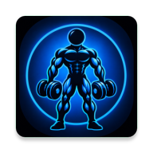

# 🏋️‍♂️ Monster GYM - Android Workout Manager

<p align="center">
  
</p>

<p align="center">
  
  
  
  
  
  
</p>

<p align="center">
  <a href="#-english-version">English Version</a> | <a href="#-versión-en-español">Versión en Español</a>
</p>

---

# 🇬🇧 English Version

## 📌 Overview
**Monster GYM** is a native Android application designed to log, manage, and master your gym workout routines easily, intuitively, and persistently. Built with Java, Material Design 3, ViewBinding, and SQLite database storage, it ensures your training logs and routine customisations are permanently preserved.

## ✨ Key Features
- 📋 **Routine Management & Calendar Abbreviations**: Create, edit, duplicate, and delete workout routines. Each routine includes custom calendar abbreviations (e.g., **SUP** for Upper Body, **INF** for Lower Body).
- 🔄 **Drag & Drop Reordering**: Seamlessly reorder routines, exercises, and exercise variations using touch drag handles powered by `ItemTouchHelper`.
- 😈 **Dynamic Devil Image Selector**: Customize routine, exercise, and variation avatars by choosing from available mascot illustrations. Custom picture selections are preserved across JSON exports and imports.
- 🏋️ **Exercises & Extra Tags**: Add exercises to any routine, featuring a dedicated **EXTRA** badge for accessory exercises.
- ⚖️ **Set Weights & Per-Set Tracking**: Dynamically configure sets, repetitions, and individual weights per set.
- 📅 **Main Screen Workout Calendar & Counters**: Interactive Monday-starting monthly calendar directly on the dashboard, displaying workout abbreviations inside orange circles for completed days.
- ⚙️ **Settings & JSON Backup**: Settings dialog featuring weight unit configuration, routine JSON backup export to Downloads, routine JSON file import, and developer credits.
- 💾 **Real-time SQLite Persistence**: Automatic local persistence using SQLite (`monstergym.db`) alongside synchronized continuous JSON exports (`gymRoutine.json`).

## 📱 User Requirements
- Android 7.0 (API 24) or higher.
- **NO internet connection is required**: all workout data is stored locally on the device.
- Optional storage permission to export or import JSON backup files.

## 🚀 How to Build and Run
Clone this repository and open it in Android Studio.

```bash
git clone [https://github.com/your-username/MonsterGYM.git](https://github.com/your-username/MonsterGYM.git)
cd MonsterGYM
```

1. Open the project folder in **Android Studio**.
2. Wait for Gradle to synchronize the dependencies.
3. Select a physical device or emulator with Android 7.0 (API 24) or higher.
4. Click **Run > Run 'app'**.

To generate a debug APK from the terminal:

```bash
./gradlew assembleDebug
```

The generated APK will be located at:

```text
app/build/outputs/apk/debug/app-debug.apk
```

## 📖 How to Use
1. Create a workout routine and set its name, description, abbreviation, and mascot image.
2. Add exercises and variations to each routine.
3. Configure the number of sets, repetitions, and weight for every variation.
4. Mark completed workout days in the monthly calendar.
5. Export your routines as a JSON backup from **Settings**.
6. Import a JSON file to restore or preload your routines on another device.

## 🗂️ JSON Preload Format
You can preload routines by importing a JSON file from **Settings > Import JSON**.

The file must contain a `routines` array. Each routine can include main exercises and optional extra exercises.

```json
{
  "routines": [
    {
      "id": "rutina_tren_superior",
      "name": "Tren Superior",
      "description": "Lunes y Jueves",
      "abbreviation": "SUP",
      "image": "red_devil_mad",
      "exercises": [
        {
          "id": "ejercicio_jalon",
          "name": "Jalón",
          "image": "red_devil_mad",
          "variations": [
            {
              "id": "variacion_jalon_maquina",
              "name": "Máquina",
              "image": "red_devil_mad",
              "sets": [
                {
                  "number": 1,
                  "weight_kg": 50,
                  "reps": 10
                }
              ],
              "notes": ""
            }
          ]
        }
      ],
      "extra_exercises": []
    }
  ]
}
```

### Field Reference

| Field | Description |
|---|---|
| `routines` | Main array containing all workout routines. |
| `id` | Unique identifier for the routine, exercise, or variation. |
| `name` | Display name. |
| `description` | Optional routine description, such as training days. |
| `abbreviation` | Short abbreviation shown in the calendar, for example `SUP` or `INF`. |
| `image` | Mascot image identifier, for example `red_devil_mad`. |
| `exercises` | Main exercises included in the routine. |
| `extra_exercises` | Accessory exercises marked with the `EXTRA` badge. |
| `variations` | Exercise variations, such as machine, dumbbell, or cable versions. |
| `sets` | List of sets for each variation. |
| `number` | Set number. |
| `weight_kg` | Weight used in kilograms. Use `0` for bodyweight or unweighted exercises. |
| `reps` | Number of repetitions. |
| `notes` | Optional notes for the variation. |

## 🛠️ Tech Stack
- **Language**: Java
- **UI Framework**: Android ViewBinding, Material Components 3
- **Database**: SQLite (`SQLiteOpenHelper`)
- **Data Interchange**: JSON
- **Build System**: Gradle 8.x
- **Minimum Android Version**: API 24
- **Target Android Version**: API 34/37

## 🧑‍💻 Developer Requirements
- Android Studio Koala / Jellyfish or newer.
- Java JDK 11 or 17.
- Android SDK with minimum API 24 and target API 34/37.
- A physical Android device or emulator running API 24 or higher.

## 📁 App Structure
```text
com.example.monstergym/
├── adapter/     # RecyclerView Adapters (Routine, Exercise, Variation, Calendar, WorkoutLog)
├── data/        # SQLite Database Helper & Workout Data Manager (JSON & SQLite)
├── model/       # Data classes (Routine, Exercise, ExerciseVariation, WorkoutLog, CalendarDay)
├── ui/          # Activities (MainOptions, RoutinesList, RoutineDetail, VariationsList, VariationDetail, Calendar, Welcome)
└── utils/       # Helpers (DevilImagePickerHelper)
```

## 📸 Screenshots
*App screenshots will be added soon.*

## 📄 Licensing & Attribution
- **License**: This project is distributed under the [MIT License](LICENSE).
- **Developed by**: MGR *(Mario García Rodríguez)*.
- **Characters & Illustrations**: Based on video assets from Vecteezy: [Monster Stock Videos by Vecteezy](https://www.vecteezy.com/free-videos/monster), with customized versions created for the app.

---

*Developed for comprehensive workout management at Monster GYM.*

---

# 🇪🇸 Versión en Español

## 📌 Descripción General
**Monster GYM** es una aplicación nativa para Android diseñada para ayudarte a registrar, gestionar y dominar tus entrenamientos en el gimnasio de forma rápida, intuitiva y persistente. Desarrollada en Java, Material Design 3, ViewBinding y SQLite.

## ✨ Características Principales
- 📋 **Gestión de Rutinas y Abreviaturas**: Crea, edita, duplica y elimina rutinas de entrenamiento con abreviaturas personalizadas para el calendario.
- 🔄 **Reordenamiento por Arrastre (Drag & Drop)**: Reorganiza tus rutinas, ejercicios y variaciones de forma fluida mediante tiradores de arrastre táctiles.
- 😈 **Selector Dinámico de Diablillos**: Personaliza los avatares de tus rutinas, ejercicios y variaciones eligiendo entre las ilustraciones de diablillos disponibles. Las fotos personalizadas se conservan en las exportaciones e importaciones JSON.
- 🏋️ **Ejercicios y Etiqueta EXTRA**: Añade ejercicios y marca elementos accesorios con la etiqueta **EXTRA**.
- ⚖️ **Series y Pesos**: Configura número de series, repeticiones y pesos individuales por serie.
- 📅 **Calendario y Contadores**: Calendario mensual interactivo en la pantalla principal con abreviaturas en círculos naranjas y contadores de días de entrenamiento.
- ⚙️ **Ajustes y Respaldo JSON**: Menú de ajustes con exportación e importación de archivos JSON de rutinas.
- 💾 **Persistencia Real en SQLite**: Almacenamiento local mediante SQLite (`monstergym.db`) y sincronización con `gymRoutine.json`.

## 📱 Requisitos de Usuario
- Android 7.0 (API 24) o superior.
- **NO requiere conexión a Internet**: todos los datos de entrenamiento se guardan localmente en el dispositivo.
- Permiso de almacenamiento opcional para exportar o importar copias de seguridad en JSON.

## 🚀 Cómo Compilar y Ejecutar
Clona este repositorio y ábrelo en Android Studio.

```bash
git clone [https://github.com/your-username/MonsterGYM.git](https://github.com/your-username/MonsterGYM.git)
cd MonsterGYM
```

1. Abre la carpeta del proyecto en **Android Studio**.
2. Espera a que Gradle sincronice las dependencias.
3. Selecciona un dispositivo físico o emulador con Android 7.0 (API 24) o superior.
4. Haz clic en **Run > Run 'app'**.

Para generar una APK de depuración desde la terminal:

```bash
./gradlew assembleDebug
```

La APK generada estará en:

```text
app/build/outputs/apk/debug/app-debug.apk
```

## 📖 Cómo Usarla
1. Crea una rutina y configura su nombre, descripción, abreviatura e imagen de diablillo.
2. Añade ejercicios y variaciones a cada rutina.
3. Configura el número de series, repeticiones y peso de cada variación.
4. Marca los días de entrenamiento completados en el calendario mensual.
5. Exporta tus rutinas como copia de seguridad JSON desde **Ajustes**.
6. Importa un archivo JSON para restaurar o precargar tus rutinas en otro dispositivo.

## 🗂️ Formato JSON para Precargar Datos
Puedes precargar rutinas importando un archivo JSON desde **Ajustes > Importar JSON**.

El archivo debe contener un array llamado `routines`. Cada rutina puede incluir ejercicios principales y, opcionalmente, ejercicios extra.

```json
{
  "routines": [
    {
      "id": "rutina_tren_superior",
      "name": "Tren Superior",
      "description": "Lunes y Jueves",
      "abbreviation": "SUP",
      "image": "red_devil_mad",
      "exercises": [
        {
          "id": "ejercicio_jalon",
          "name": "Jalón",
          "image": "red_devil_mad",
          "variations": [
            {
              "id": "variacion_jalon_maquina",
              "name": "Máquina",
              "image": "red_devil_mad",
              "sets": [
                {
                  "number": 1,
                  "weight_kg": 50,
                  "reps": 10
                }
              ],
              "notes": ""
            }
          ]
        }
      ],
      "extra_exercises": []
    }
  ]
}
```

### Descripción de los Campos

| Campo | Descripción |
|---|---|
| `routines` | Array principal con todas las rutinas de entrenamiento. |
| `id` | Identificador único de la rutina, ejercicio o variación. |
| `name` | Nombre visible en la aplicación. |
| `description` | Descripción opcional de la rutina, por ejemplo los días de entrenamiento. |
| `abbreviation` | Abreviatura mostrada en el calendario, por ejemplo `SUP` o `INF`. |
| `image` | Identificador de la imagen del diablillo, por ejemplo `red_devil_mad`. |
| `exercises` | Ejercicios principales incluidos en la rutina. |
| `extra_exercises` | Ejercicios accesorios marcados con la etiqueta `EXTRA`. |
| `variations` | Variantes de cada ejercicio, como máquina, mancuernas o polea. |
| `sets` | Lista de series de cada variación. |
| `number` | Número de la serie. |
| `weight_kg` | Peso utilizado en kilogramos. Usa `0` para ejercicios con peso corporal o sin carga. |
| `reps` | Número de repeticiones. |
| `notes` | Notas opcionales para la variación. |

## 🛠️ Tecnologías Utilizadas
- **Lenguaje**: Java
- **Interfaz de Usuario**: Android ViewBinding, Material Components 3
- **Base de Datos**: SQLite (`SQLiteOpenHelper`)
- **Intercambio de Datos**: JSON
- **Sistema de Compilación**: Gradle 8.x
- **Versión Mínima de Android**: API 24
- **Versión Objetivo de Android**: API 34/37

## 🧑‍💻 Requisitos para Desarrolladores
- Android Studio Koala / Jellyfish o superior.
- Java JDK 11 o 17.
- Android SDK con versión mínima API 24 y versión objetivo API 34/37.
- Un dispositivo Android físico o emulador con API 24 o superior.

## 📁 Estructura de la Aplicación
```text
com.example.monstergym/
├── adapter/     # Adaptadores de RecyclerView (Rutinas, Ejercicios, Variaciones, Calendario, Logs)
├── data/        # Administrador de datos y SQLite (GymDatabaseHelper, WorkoutDataManager)
├── model/       # Modelos de datos (Routine, Exercise, ExerciseVariation, WorkoutLog, CalendarDay)
├── ui/          # Actividades (MainOptions, RoutinesList, RoutineDetail, VariationsList, VariationDetail, Calendar, Welcome)
└── utils/       # Utilidades (DevilImagePickerHelper)
```

## 📸 Capturas de Pantalla
*Las capturas de pantalla de la aplicación se añadirán próximamente.*

## 📄 Licencias y Atribución
- **Licencia**: Este proyecto se distribuye bajo la [Licencia MIT](License).
- **Desarrollado por**: MGR *(Mario García Rodríguez)*.
- **Personajes e Ilustraciones**: Basados en recursos de video de Vecteezy: [Monster Stock Videos by Vecteezy](https://www.vecteezy.com/free-videos/monster), con versiones personalizadas para la app.

---

*Desarrollado para la gestión integral de entrenamientos en Monster GYM.*
