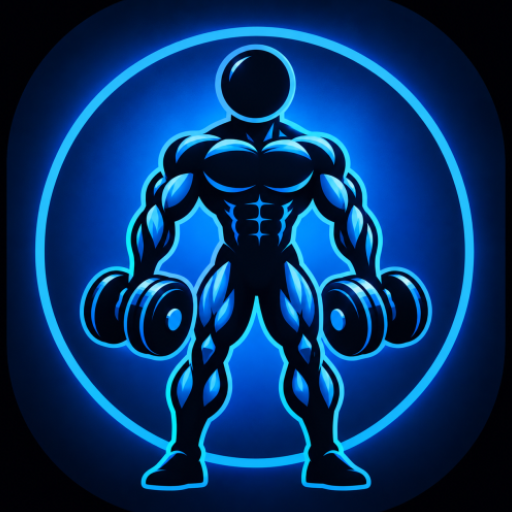

# 🏋️‍♂️ Monster GYM - Android Workout Manager

<p align="center">
  
</p>

<p align="center">
  
  
  
  
  
  
</p>

<p align="center">
  <a href="#-english-version">English Version</a> | <a href="#-versión-en-español">Versión en Español</a>
</p>

---

# 🇬🇧 English Version

## 📌 Overview
**Monster GYM** is a native Android application designed to log, manage, and master your gym workout routines easily, intuitively, and persistently. Built with Java, Material Design 3, ViewBinding, and SQLite database storage, it ensures your training logs and routine customisations are permanently preserved.

## ✨ Key Features
- 📋 **Routine Management & Calendar Abbreviations**: Create, edit, duplicate, and delete workout routines. Each routine includes custom calendar abbreviations (e.g., **SUP** for Upper Body, **INF** for Lower Body).
- 🔄 **Drag & Drop Reordering**: Seamlessly reorder routines, exercises, and exercise variations using touch drag handles powered by `ItemTouchHelper`.
- 😈 **Dynamic Devil Image Selector**: Customize routine, exercise, and variation avatars by choosing from available mascot illustrations. Custom picture selections are preserved across JSON exports and imports.
- 🏋️ **Exercises & Extra Tags**: Add exercises to any routine, featuring a dedicated **EXTRA** badge for accessory exercises.
- ⚖️ **Set Weights & Per-Set Tracking**: Dynamically configure sets, repetitions, and individual weights per set.
- 📅 **Main Screen Workout Calendar & Counters**: Interactive Monday-starting monthly calendar directly on the dashboard, displaying workout abbreviations inside orange circles for completed days.
- ⚙️ **Settings & JSON Backup**: Settings dialog featuring weight unit configuration, routine JSON backup export to Downloads, routine JSON file import, and developer credits.
- 💾 **Real-time SQLite Persistence**: Automatic local persistence using SQLite (`kobasgym.db`) alongside synchronized continuous JSON exports (`gymRoutine.json`).

## 📁 App Structure
```text
com.example.kobasgym/
├── adapter/     # RecyclerView Adapters (Routine, Exercise, Variation, Calendar, WorkoutLog)
├── data/        # SQLite Database Helper & Workout Data Manager (JSON & SQLite)
├── model/       # Data classes (Routine, Exercise, ExerciseVariation, WorkoutLog, CalendarDay)
├── ui/          # Activities (MainOptions, RoutinesList, RoutineDetail, VariationsList, VariationDetail, Calendar, Welcome)
└── utils/       # Helpers (DevilImagePickerHelper)
```

## 🛠️ Prerequisites & Tech Stack
- **Prerequisites**: Android Studio (Koala / Jellyfish or newer), Android SDK (Min SDK 24, Target SDK 34/37), Java JDK 11/17, Physical Device or Emulator (API 24+).
- **Language**: Java
- **UI Framework**: Android ViewBinding, Material Components 3
- **Database**: SQLite (`SQLiteOpenHelper`)
- **Data Interchange**: JSON

## 🚀 How to Build and Run
1. Clone the repository to your local machine:
   ```bash
   git clone https://github.com/your-username/MonsterGYM.git
   ```
2. Open the project folder in **Android Studio**.
3. Allow Gradle to sync dependencies automatically.
4. Select an Android device or emulator running API 24 or higher.
5. Click **Run > Run 'app'** or run via Gradle Wrapper:
   ```bash
   ./gradlew assembleDebug
   ```

## 📸 Screenshots
*App screenshots will be added soon.*

## 📄 Licensing & Attribution / Licencias y Atribución

- **License**: This project is distributed under the **MIT License**.
- **Developed by**: Mario García Rodríguez.
- **Characters & Illustrations**: Based on video assets from Vecteezy: [Monster Stock Videos by Vecteezy](https://www.vecteezy.com/free-videos/monster), with customized versions created for the app.

---

*Developed for comprehensive workout management at Monster GYM.*


---

# 🇪🇸 Versión en Español

## 📌 Descripción General
**Monster GYM** es una aplicación nativa para Android diseñada para ayudarte a registrar, gestionar y dominar tus entrenamientos en el gimnasio de forma rápida, intuitiva y persistente. Desarrollada en Java, Material Design 3, ViewBinding y SQLite.

## ✨ Características Principales
- 📋 **Gestión de Rutinas y Abreviaturas**: Crea, edita, duplica y elimina rutinas de entrenamiento con abreviaturas personalizadas para el calendario.
- 🔄 **Reordenamiento por Arrastre (Drag & Drop)**: Reorganiza tus rutinas, ejercicios y variaciones de forma fluida mediante tiradores de arrastre táctiles.
- 😈 **Selector Dinámico de Diablillos**: Personaliza los avatares de tus rutinas, ejercicios y variaciones eligiendo entre las ilustraciones de diablillos disponibles. Las fotos personalizadas se conservan en las exportaciones e importaciones JSON.
- 🏋️ **Ejercicios y Etiqueta EXTRA**: Añade ejercicios y marca elementos accesorios con la etiqueta **EXTRA**.
- ⚖️ **Series y Pesos**: Configura número de series, repeticiones y pesos individuales por serie.
- 📅 **Calendario y Contadores**: Calendario mensual interactivo en la pantalla principal con abreviaturas en círculos naranjas y contadores de días de entrenamiento.
- ⚙️ **Ajustes y Respaldo JSON**: Menú de ajustes con exportación e importación de archivos JSON de rutinas.
- 💾 **Persistencia Real en SQLite**: Almacenamiento local mediante SQLite (`kobasgym.db`) y sincronización con `gymRoutine.json`.

## 📁 Estructura de la Aplicación
```text
com.example.kobasgym/
├── adapter/     # Adaptadores de RecyclerView (Rutinas, Ejercicios, Variaciones, Calendario, Logs)
├── data/        # Administrador de datos y SQLite (GymDatabaseHelper, WorkoutDataManager)
├── model/       # Modelos de datos (Routine, Exercise, ExerciseVariation, WorkoutLog, CalendarDay)
├── ui/          # Actividades (MainOptions, RoutinesList, RoutineDetail, VariationsList, VariationDetail, Calendar, Welcome)
└── utils/       # Utilidades (DevilImagePickerHelper)
```

## 🛠️ Requisitos y Tecnologías
- **Qué se necesita**: Android Studio, Android SDK (Mínimo API 24, Destino API 34/37), JDK 11/17, Dispositivo físico o Emulador Android.
- **Lenguaje**: Java
- **Interfaz de Usuario**: Android ViewBinding, Material Components 3
- **Base de Datos**: SQLite (`SQLiteOpenHelper`)
- **Intercambio de Datos**: JSON

## 🚀 Cómo Compilar y Ejecutar
1. Clona el repositorio en tu equipo:
   ```bash
   git clone https://github.com/your-username/MonsterGYM.git
   ```
2. Abre la carpeta del proyecto en **Android Studio**.
3. Deja que Gradle sincronice las dependencias automáticamente.
4. Selecciona un dispositivo físico o emulador con Android 7.0 (API 24) o superior.
5. Haz clic en **Run > Run 'app'** o ejecuta la compilación desde la terminal:
   ```bash
   ./gradlew assembleDebug
   ```

## 📸 Capturas de Pantalla
*Las capturas de pantalla de la aplicación se añadirán próximamente.*

---

## 📄 Licencias y Atribución

- **Licencia**: Este proyecto se distribuye bajo la **Licencia MIT** (*MIT License*).
- **Desarrollado por**: Mario García Rodríguez.
- **Personajes e Ilustraciones**: Basados en recursos de video de Vecteezy: [Monster Stock Videos by Vecteezy](https://www.vecteezy.com/free-videos/monster), con versiones personalizadas para la app.

---

*Desarrollado para la gestión integral de entrenamientos en Monster GYM.*
